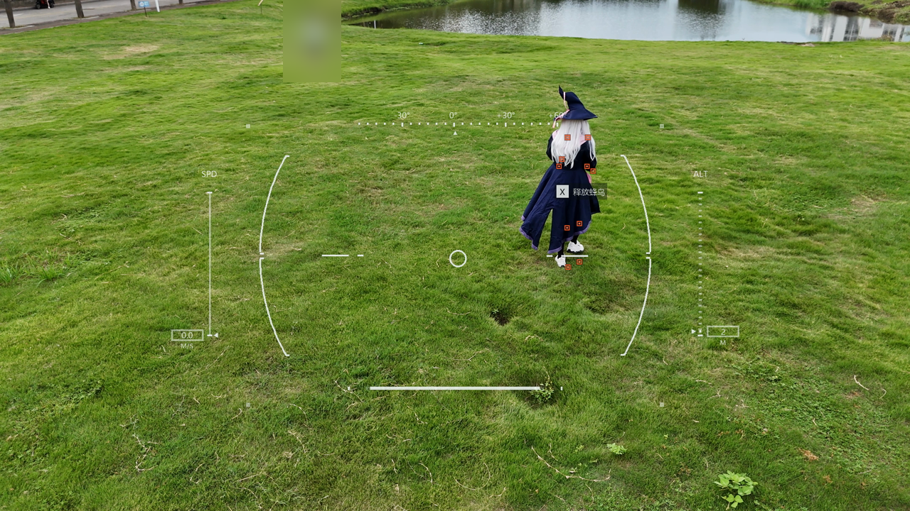
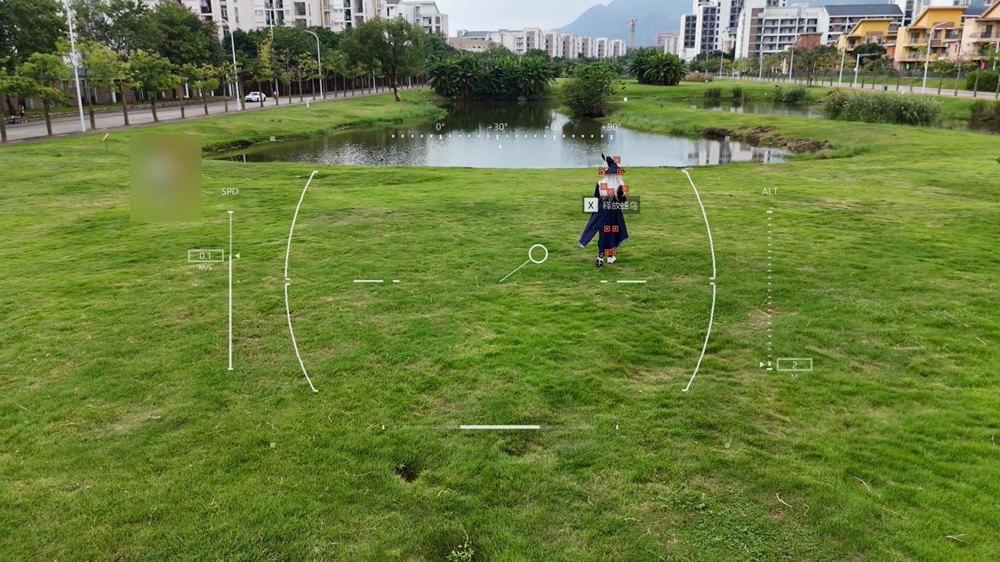
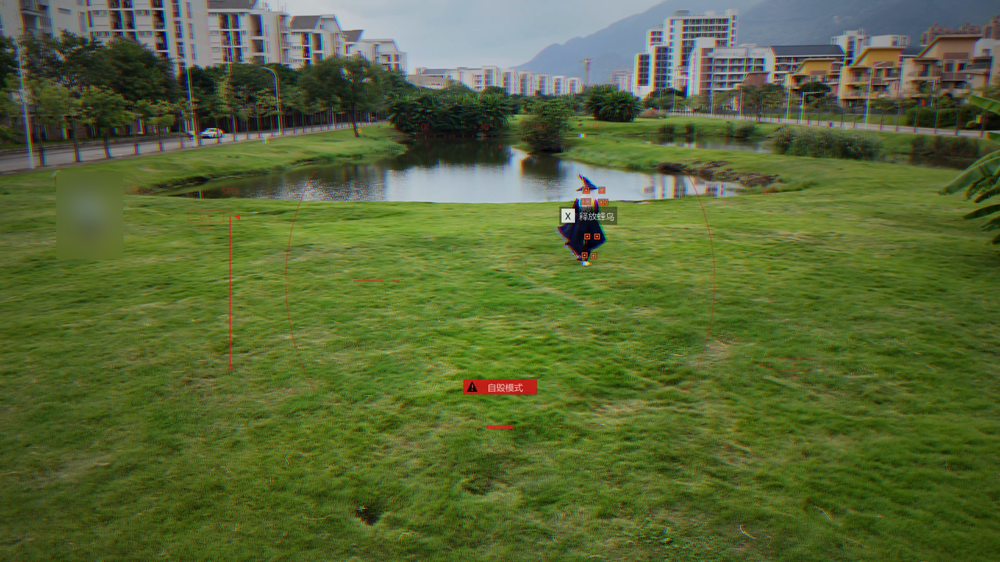

<p align="center">
  
</p>

<p align="center">
  <strong>让真实航拍，拥有游戏无人机的控制视角。</strong><br />
  DJI 视频 + SRT 遥测 → 动态 HUD → 透明蒙版 / 绿幕 / PNG 序列 / 成片
</p>

<p align="center">
  
  
  
  
  
  
</p>

<p align="center">
  <a href="#效果预览">效果预览</a> ·
  <a href="#快速开始">快速开始</a> ·
  <a href="#导出与合成">导出与合成</a> ·
  <a href="#参数配置">参数配置</a> ·
  <a href="#人物检测">人物检测</a> ·
  <a href="#开发与验证">开发与验证</a> ·
  <a href="https://github.com/weijianxian/Landon-Harrison-with-DJI/issues">反馈问题</a>
</p>

---

## 项目概览

**Landon Harrison with DJI** 是一个本地运行的航拍 HUD 渲染工具。它读取 DJI 视频及配套 SRT，绘制游戏风格的无人机界面，并输出可独立剪辑的蒙版或直接合成成片。

| 能力 | 效果 |
| :--- | :--- |
| 遥测驱动 | 读取高度、速度与方向；缺失速度时可从 GPS 估算 |
| 镜头响应 | 空心瞄准圆圈随画面运动偏移，通过细线连接中心；顶部方向刻度滑动 |
| 游戏化 HUD | 双侧弧形括号、SPD / ALT 标尺、角落标记与生命条 |
| 人物关键点 | 可选 YOLOv8 Pose 检测，用偏红小方块标记关键点 |
| 蜂鸟提示 | 选择离瞄准圈最近的人，限速、平滑跟随人物框 |
| 自毁模式 | 默认末尾 3 秒切换为淡红细线，显示警告牌；合成时加入色差与暗角 |
| 多种交付 | 默认透明 MOV，也支持绿幕 MOV / MP4 与透明 PNG 序列 |
| 批量渲染 | 自动配对同名视频与 SRT，保留独立 mask，并合成原尺寸视频 |

> 视频与检测都在本机处理。生命值、蜂鸟提示和自毁模式是视频视觉效果；本工具不连接或控制无人机。

## 效果预览

以下画面截自同一段约 10.94 秒的 DJI 素材，使用 1080p HUD 合成至 4K 视频，人物检测间隔为 2 秒。左侧人物经过高斯模糊处理，右侧人物保留原画面。

### 01 · 起始视角 — 0.5 s

白色 HUD、人物关键点与蜂鸟提示同时呈现，生命条按片长开始递减。



### 02 · 镜头运动 — 6.5 s

方向条随镜头滑动，瞄准圆圈偏移并连接屏幕中心；生命条从两侧向中心缩短。



### 03 · 自毁模式 — 9.5 s

HUD 切换为淡红细线，出现自毁警告牌；背景叠加红蓝色差与暗角。



## 快速开始

### 1. 准备环境

| 依赖 | 要求 |
| :--- | :--- |
| Python | 3.13+，由 uv 管理 |
| uv | 用于依赖安装与命令执行 |
| FFmpeg / ffprobe | 安装后加入 `PATH` |
| YOLOv8 Pose | 可选，启用人物检测时安装 |

```powershell
git clone https://github.com/weijianxian/Landon-Harrison-with-DJI.git
cd Landon-Harrison-with-DJI
uv sync
uv run bird-dji --help
```

### 2. 放入素材

将同名视频与字幕放进 `videos/`。名称可以自定义，扩展名匹配不区分大小写。

```text
videos/
├── DJI_20261002102503_0016_D.MP4
└── DJI_20261002102503_0016_D.SRT
```

### 3. 一键生成

```powershell
uv run bird-dji batch videos --output-dir outputs
```

每段素材会生成合成视频、透明 mask 和配置侧文件。支持 NVIDIA 编码的显卡可加 `--encoder h264_nvenc`；已有输出需加 `--overwrite`。

## 导出与合成

| 输出类型 | 参数 | 输出目标 | 使用场景 |
| :--- | :--- | :--- | :--- |
| 透明 MOV | `--mask-format transparent`（默认） | `.mov` 文件 | 保留半透明线条，直接叠加 |
| 绿幕视频 | `--mask-format green` | `.mov` / `.mp4` 文件 | 在剪辑软件中抠像 |
| 透明 PNG 序列 | `--mask-format png` | 目录 | 按帧导入与离线合成 |
| 合成视频 | `render` / `batch` | `.mp4` 文件 | 直接观看与交付 |

透明 MOV 使用 QuickTime Animation（`qtrle` / `argb`）保留 alpha；普通 H.264 MP4 不保留透明通道。播放器可能将透明背景显示为黑色，实际叠加时仍然透明。

### 单独导出 mask

```powershell
uv run bird-dji mask --video videos/DJI_20261002102503_0016_D.MP4 --srt videos/DJI_20261002102503_0016_D.SRT -o outputs/drone_mask.mov
```

提供 `--video` 自动匹配画面尺寸、帧率及片长。仅有 SRT 也能生成：

```powershell
uv run bird-dji mask --srt videos/DJI_20261002102503_0016_D.SRT --width 3840 --height 2160 --fps 30000/1001 -o outputs/drone_mask.mov
```

默认 `--mask-format transparent` 导出带 alpha 的透明 MOV。另支持绿幕视频和透明 PNG 序列：

```powershell
# 纯绿底 MOV（无损），也可将输出扩展名改为 .mp4
uv run bird-dji mask --video videos/DJI_20261002102503_0016_D.MP4 --srt videos/DJI_20261002102503_0016_D.SRT --mask-format green -o outputs/drone_green.mov

# output 为目录；每张 PNG 都保留透明度
uv run bird-dji mask --video videos/DJI_20261002102503_0016_D.MP4 --srt videos/DJI_20261002102503_0016_D.SRT --mask-format png -o outputs/drone_frames
```

PNG 序列从 `frame_000001.png` 开始，目录中的 `manifest.json` 记录帧率、时长和帧数；导入剪辑软件时设置对应帧率。加 `--overwrite` 可以替换本工具生成的序列目录，含其他文件的目录不会被覆盖。绿幕使用纯绿色背景（RGB 0,255,0），需在剪辑软件中抠像；半透明线条建议优先使用透明 MOV 或 PNG。`render` 和 `batch` 仍生成透明 MOV 并自动合成，`overlay` 接受透明 MOV。

### 合成已有 mask

```powershell
uv run bird-dji overlay --video videos/DJI_20261002102503_0016_D.MP4 --mask outputs/drone_mask.mov -o outputs/drone_hud.mp4
```

也可以直接调用 FFmpeg（mask 与视频需同尺寸、同起点）：

```powershell
ffmpeg -i videos/DJI_20261002102503_0016_D.MP4 -i outputs/drone_mask.mov -filter_complex "[0:v][1:v]overlay=0:0:format=auto:alpha=straight[v]" -map "[v]" -map "0:a?" -c:v libx264 -crf 18 -preset fast -pix_fmt yuv420p -c:a copy -movflags +faststart outputs/drone_hud.mp4
```

### 自动处理

```powershell
# 一条命令生成 mask 并导出合成视频（保留 mask）
uv run bird-dji render --video videos/DJI_20261002102503_0016_D.MP4 --srt videos/DJI_20261002102503_0016_D.SRT -o outputs/drone_hud.mp4

# 批量配对目录内同名视频和 SRT，不区分扩展名大小写
uv run bird-dji batch videos --output-dir outputs

# 单帧透明 PNG 预览
uv run bird-dji preview --video videos/DJI_20261002102503_0016_D.MP4 --srt videos/DJI_20261002102503_0016_D.SRT --time 4 -o outputs/hud.png
```

## 参数配置

| 参数 | 默认值 | 说明 |
| :--- | :--- | :--- |
| `--duration` | 素材片长 | 只处理前 N 秒 |
| `--hud-scale` | `0.65` | HUD 布局大小，允许 `0.5–1` |
| `--line-width` | `4` | 1080p 基准线宽，随分辨率缩放 |
| `--opacity` | `0.85` | HUD 透明度 |
| `--reticle` | `auto` | 从画面估计圆圈运动；`fixed` 固定居中 |
| `--reticle-gain` | `12` | 转镜头响应强度 |
| `--reticle-range` | `0.18` | 最大偏移占 HUD 宽 / 高的比例，上限 `0.25` |
| `--width` / `--height` | 匹配视频 | mask 分辨率，两个参数同时指定 |
| `--fps` | 匹配视频 | 支持 `30000/1001` 等分数帧率 |
| `--window` | `1` | GPS 速度估算窗口，单位秒 |
| `--offset` | `0` | 视频 t 秒读取 SRT t + offset 秒 |
| `--pose-interval` | `2` | 人物检测间隔，单位秒，即默认 0.5 次 / 秒 |
| `--self-destruct-last` | `3` | 末尾多少秒进入自毁模式 |
| `--self-destruct-at` | 未指定 | 指定自毁开始秒数，优先于末尾时间 |
| `--release-follow-speed` | `180` | 1080p 下蜂鸟提示最大跟随速度，像素 / 秒 |
| `--encoder` | `libx264` | 合成编码器，可选 `h264_nvenc` |
| `--crf` | `18` | 合成质量参数，NVENC 使用对应 CQ 值 |
| `--overwrite` | 关闭 | 替换已有输出 |

更明显的镜头响应可用 `--reticle-gain 16 --reticle-range 0.22`。默认布局下，1080p 圆圈的横向 / 纵向偏移上限约为 225 / 126 像素，转动时快速响应，停止后缓慢回中。

合成保留原视频尺寸、时间顺序及可复制的原音轨。输出会重新编码为 8-bit H.264，目前不保留源片的 10-bit 位深、DJI 私有数据流或 HDR 元数据。

## 人物检测

安装可选依赖并把官方 `yolov8n-pose.pt` 放到 `models/`（可用 `--pose-model` 指定其他 YOLOv8 pose 权重）：

```powershell
uv sync --extra pose
uv run --extra pose bird-dji batch videos --output-dir outputs --pose --encoder h264_nvenc --overwrite
```

`--pose` 同样适用于 `mask`、`render` 和 `preview`。人体关键点直接绘入透明 mask，偏红的橙色小方框内带中心菱形，不画骨架、不画人体包围框。默认按视频时间每秒检测 0.5 次（每 2 秒一次：0、2、4…秒），以该时刻附近的视频帧为输入；两次扫描之间保持上次坐标，下一次扫描覆盖，检测消失就清除。保存旁边的 `.pose.json` 可查看扫描时间、人数、归一化关键点坐标与置信度。离线推理和导出速度取决于硬件。

默认 `--pose-confidence 0.5` 过滤低可信和遮挡的关键点；`--pose-interval 2` 为扫描间隔，可改为 `1` 使用每秒一次；`--pose-device cpu` 可改成 `0` 使用 CUDA（需安装支持 CUDA 的 PyTorch）。模型在本地运行，视频不会上传。关键点推理输入尺寸默认 `--pose-imgsz 960`，可调为 `1280` 提高细节识别。坐标按完整视频画面映射，不随中央 HUD 缩小。

官方模型与关键点 API：[YOLOv8 模型](https://docs.ultralytics.com/models/yolov8/)、[Keypoints](https://docs.ultralytics.com/reference/engine/results/#ultralytics.engine.results.Keypoints)。

## 自毁模式与释放蜂鸟提示

默认在导出视频最后 3 秒进入自毁模式：约 0.12 秒内快速切换为红色 HUD，括号和刻度变细变淡，速度填充线、水平短线和生命值填充条保持鲜明的红色，瞄准圆圈及连接线进一步淡化。红色警告牌内有黑色警告三角与“自毁模式”。保留实拍画面，不做末尾黑屏或断信号效果。`--self-destruct-last 5` 改为最后 5 秒；`--self-destruct-at 6` 指定从第 6 秒开始（优先于末尾秒数）；`--no-self-destruct` 关闭。短于 3 秒的片段从开头进入过渡。红橙色人体关键点保持原样。

开启 `--pose` 后，选择画面中 bbox 中心距离移动瞄准圆圈最近的人，显示 `X 释放蜂鸟`（按屏幕像素距离选择）。提示第一次出现时，其整体中心放在 bbox 中心；随后按 0.2 秒平滑响应跟随，并限制最大速度为 1080p 下 180 像素/秒（随分辨率缩放），不瞬间跳到新位置。人物框默认每 2 秒刷新一次，按相邻扫描 bbox 的重叠率关联；未检测到人物时隐藏，切换人物时重新居中。这里只绘制视频 UI，不绑定按键或实际无人机动作。

用 `--release-follow-speed 100` 降低移动速度，`--no-release-prompt` 关闭提示。`.pose.json` 保存归一化 bbox 和临时跟踪编号，`.release.json` 保存触发时刻与初始位置，方便检查。bbox 只用于判定，不画出来。

自毁阶段合成时还会给实拍背景加入轻微红蓝色差和暗角，HUD 保持清楚，不添加黑屏。Mask 旁边的 `.hud.json` 保存开始时间，使用 `bird-dji overlay` 时会自动读取。透明 mask 自身包含红色 UI，背景色差/暗角须在合成阶段应用；直接使用普通 FFmpeg overlay 示例只叠 UI。移动 mask 时一并保留同名 `.hud.json`。

## 数据来源与行为说明

<details>
<summary>展开：遥测字段、视觉估算和生命条的具体含义</summary>

- 底部横条为模拟无人机生命值：按本次导出片长线性递减，第一帧满格、最后一帧空格；白色填充从两侧对称向中心缩短，空槽保留淡色底轨。这不是飞控真实电量或生命值读数，SRT offset 不影响其进度。`--duration` 截短时使用截短后的片长。

- `rel_alt` 用于 ALT，单位米；缺失显示 `--`。高度尺视觉范围 0–100 米，数值不截断。
- 优先读取 `h_speed` / `hspeed` / `horizontal_speed`，假定单位 m/s；没有这些字段时用 GPS 在默认一秒窗口内的位移估算**水平地速**。先统计整份 SRT 的最高速度，再按 `当前速度 / 最高速度` 映射 SPD 尺；最高速度对应满格，零速度对应底部，整段零速度时安全显示空条。每段独立统计，即使 `--duration` 截短输出，也使用完整 SRT 的峰值。数字仍是实际 m/s，保留一位小数。
- 优先读取 `yaw` / `heading` / `flight_yaw`，假定单位度；没有朝向字段时显示 **GPS 航迹方向**，它与机头/相机朝向可能不同。窗口位移不足 0.5 米或速度不足 0.5 m/s 时显示 `--`，避免悬停时随机跳方向。
- 有视频时，顶部方向条从视频起点的 0° 开始，根据全局画面横向位移累计滑动，只显示带正负号的相对角度，不显示说明文字。停止转镜头后方向条保持累计位置，不随圆圈回中而复位。这是游戏化的视觉方向（整屏横移映射为 180°），未标定真实相机视角，也不代表地理方位。
- 仅有 SRT 时，顶部使用字幕朝向或 GPS 航迹；有有效绝对方向数据才显示北/东/南/西，方向未知显示 `--`。跨越 359°→0° 按最短方向插值；Windows 使用微软雅黑，其他环境回退英文方向。`--reticle fixed` 只固定圆圈，有视频时顶部仍随镜头滑动。
- 左右括号和刻度固定居中，整体缩至原布局的 65%。有视频时中心圆圈用 OpenCV 稀疏光流和 RANSAC 的全局画面位移估计转镜头方向，并平滑、限幅，在停止转镜头后渐渐回中。移动人物的局部运动尽量通过全局拟合排除。
- 圆圈运动是**视觉效果估计**，不是云台角度读数：画面平移也可能来自无人机移动，无法仅凭图像区分。弱纹理、遮挡或剧烈跳切时不采用不可靠位移。仅提供 SRT 时无法推断镜头方向，圆圈固定居中。不会用 GPS 航迹假装相机朝向，也不会根据 GPS 推断画面倾斜。
- 字幕时间轴为准，缺失/结束后的数据不会无限沿用。GPS 是估算数据，不是飞控速度读数，短视频边缘使用可用的单侧窗口。

本地验证用的两组 DJI 素材仅含 GPS 和高度。默认一秒估算窗口下，0015 的峰值约 0.562 m/s，0016 约 0.149 m/s；它们是各自的满格值，GPS 精度可能影响低速读数。验证素材未随仓库发布。

</details>

## 开发与验证

Python 依赖通过 uv 管理。测试覆盖 SRT 解析、方向插值、镜头运动、生命条、自毁模式、人物提示，以及透明 / 绿幕 / PNG 导出的编码结果。导出与运动测试需要 FFmpeg。

```powershell
uv run python -m unittest discover -s tests -v
```

输出先写入临时目录，完成后才成为正式文件；不会覆盖输入视频。`videos/` 和 `outputs/` 已加入 Git 忽略。

### 项目结构

```text
src/bird_dji/
├── cli.py          # 命令行入口
├── telemetry.py    # DJI SRT 与遥测估算
├── motion.py       # 镜头运动与相对方向
├── hud.py          # HUD 绘制与自毁状态
├── pose.py         # YOLOv8 关键点与人物框
├── release.py      # 蜂鸟目标选择与提示跟随
└── video.py        # mask 导出与 FFmpeg 合成
tests/              # 行为与编码验证
docs/assets/        # README 效果截图
```

### 后续方向

- Fusion Fuse：在达芬奇内调节 HUD 参数，读取独立分析缓存，计划面向免费版兼容；当前尚未发布。
- 分析缓存复用：调整 UI 时复用运动与人物数据，减少重复检测。

### 反馈与贡献

欢迎提交 [Issue](https://github.com/weijianxian/Landon-Harrison-with-DJI/issues) 或 Pull Request。问题报告请附运行命令、操作系统、FFmpeg 版本和错误日志；遥测解析问题可提供脱敏后的 SRT 片段。

项目使用 [Ultralytics YOLOv8](https://docs.ultralytics.com/models/yolov8/)、[OpenCV](https://opencv.org/)、[Pillow](https://pillow.readthedocs.io/) 与 [FFmpeg](https://ffmpeg.org/)。页面大图由 [Socialify](https://socialify.git.ci/) 提供，徽章由 [Shields.io](https://shields.io/) 提供。
