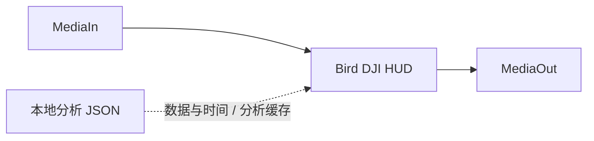
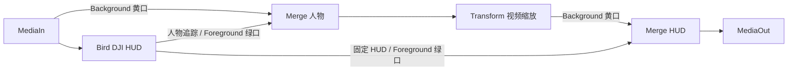

# Bird DJI HUD · Fusion Fuse

插件和 Python 分析器在同一仓库中维护。Fuse 用 Lua 绘制 HUD，读取本地 JSON 缓存；调整外观时不用再跑 YOLO，也不需要常驻 Python 服务。

本实现使用原生 Fuse 控件，不调用 UIManager、Workflow Integration、外部 Resolve API 或 Studio AI 节点。已在本机 Windows / Resolve 20.2.3 图形界面验证节点加载、HUD 绘制、素材路径自动读取和按钮分析自动载入。macOS / Linux 尚未实机测试。

## 1. 安装

当前为开发版，正式安装包后续制作。开发部署需要 uv、FFmpeg 与 `models/yolov8n-pose.pt`。在仓库根目录运行：

```powershell
powershell -ExecutionPolicy Bypass -File fusion/install.ps1
```

脚本把 Fuse、分析代码、独立 Python 环境、模型和 ffprobe 安装到当前用户的目录，不需要管理员权限。uv 自动选择适合驱动的 PyTorch 后端；首次安装 CUDA 依赖可能需下载约 2 GB：

```text
%APPDATA%/Blackmagic Design/DaVinci Resolve/Support/Fusion/Fuses/
```

已有同名插件会先备份。可用 `-WhatIf` 预览，或用 `-Destination` 指定自定义 Fuses 目录、`-ModelPath` 指定模型。安装后不再依赖原仓库路径，也无需为达芬奇设置 Python 路径。重启达芬奇，在 Fusion 页按 **Shift + Space** 搜索 **Bird DJI HUD**。

其他系统目前可手动安装 Fuse，并用命令行生成分析 JSON；内置分析按钮的启动器当前只支持 Windows。

## 2. 分析素材

检查器是一列可展开、收起的中文分组。通常在 **素材分析** 分组操作：

1. 将插件连接到素材的 `MediaIn` 后。
2. 设置人物分析开关、分析频率和检测精度（快速 / 均衡 / 精细）。
3. 点击 **分析当前素材并自动加载**，插件自动读取视频、匹配旁边的同名 SRT，并使用可用 CUDA 或 CPU。
4. 完成后自动载入数据。相同素材、模型和参数再次分析会复用结果；改频率或精度会生成独立缓存。

默认每 2 秒分析一次人物。精度对应检测输入长边 640 / 960 / 1280 像素。**人物关键点 → 方块更新间隔** 独立控制显示更新，单位是秒：默认 `1` 每秒取一次已有分析结果，`2` 每 2 秒更新一次，`0` 使用全部分析结果。两次更新之间保持上次方块坐标；圆圈、方向条、生命条仍逐帧变化。例如先按 `2` 次/秒分析，再设 `1` 秒更新一次方块。调整间隔不会重跑 YOLO 或改变原始数据；原始分析每 2 秒一次时，显示间隔设为 1 秒也不能补出缺失的检测。蜂鸟提示使用相同抽样结果，并继续逐帧平滑跟随。

分析 JSON 默认存放在安装目录的 `BirdDJI/cache`，这是数据缓存。画面像素由 Fusion 的原生磁盘缓存管理；两者用途不同。

仍可用命令行独立分析。先安装依赖，将 `yolov8n-pose.pt` 放到仓库的 `models/`：

```powershell
uv sync --extra pose
uv run --extra pose bird-dji analyze --video videos/DJI_20261002102503_0016_D.MP4 --srt videos/DJI_20261002102503_0016_D.SRT --pose -o outputs/drone.fusion.json
```

默认每 2 秒检测一次人物。去掉 `--pose` 也可以使用遥测与镜头运动。`--pose-interval`、`--pose-imgsz`、`--pose-confidence`、`--pose-device`、`--window`、`--offset` 和 `--reticle-gain` 与现有渲染命令一致。

Windows 也可运行文件选择助手：

```powershell
powershell -ExecutionPolicy Bypass -File fusion/analyze.ps1
```

助手会选择视频、自动寻找同名 SRT（找不到时再选择），并在 `outputs/` 中生成缓存。这一步是独立离线分析，不需要另开常驻应用。第一次安装依赖或缺少模型时，按终端提示处理。

## 3. 接入节点



1. 在素材的 Fusion 页将插件接在 `MediaIn` 与 `MediaOut` 之间。
2. 用 **素材分析** 的按钮自动分析，或在 **数据与时间 → 分析缓存 JSON** 中选择命令行生成的 `.fusion.json`。
3. 按需求修改各组参数，可对数值参数设置关键帧。
4. 同一路径的缓存重新分析后，点击 **重新读取缓存**。

节点提供三个可分别连接的输出，不需要复制插件或重复分析：

| 输出口 | 内容 | 背景 |
| :--- | :--- | :--- |
| 右侧：合并画面 `Output` | 原视频、人物标记、固定 HUD | 默认保留视频；**图层与布局 → 合并输出只保留透明 UI** 可改为透明 |
| 底部左：固定 HUD `OutputHUD` | 圆圈、方向条、标尺、括号、生命条、自毁警告 | 始终透明 |
| 底部右：人物追踪 `OutputPeople` | 人体关键点方块、蜂鸟提示 | 始终透明 |

无输入时也能生成透明 HUD；无缓存时使用手动速度、高度、朝向和片长进行样式预览。

### 两层合成与冲刺缩放



人物输出先与原视频合成，再对这个分支设置 Transform 的 Size 关键帧，例如 `1.12 → 1.00` 做冲刺时视野展开。最后叠加固定 HUD，圆圈、方向条、标尺和生命条保持屏幕布局。方块与蜂鸟提示随视频一起变换。直接使用主输出仍可保持原来单节点合成的接法。

检查器分组折叠不会影响已有参数或关键帧。开发版原来的 Hz 显示抽样项已改为秒间隔；旧节点重新加载后默认使用 1 秒，可重新调整。

缓存与素材应使用相同画面范围。裁切、旋转、稳定或重构图会使人物坐标偏移；优先在这些处理之前放置插件，或对处理后的视频重新分析。

## 时间同步

- **以合成起始帧为原点**：默认用合成的全局起始帧，避免分段渲染改变动画起点。
- **手动起始帧**：关闭自动原点后，填入素材第一个画面对应的 Fusion 帧号，如 `0` 或 `1001`。
- **时间线帧率**：`0` 自动读取合成帧率，必要时手动填写 `29.97`、`30` 等。
- **素材偏移**：剪掉原片开头 2 秒后设为 `2`，正值表示从缓存更晚的位置开始。
- **素材时间倍率**：正常播放为 `1`，2 倍速为 `2`；曲线变速可对素材偏移设置关键帧来匹配来源时间。

在有效缓存时间之外，HUD 隐藏。视觉数据按源帧读取，人物方块在两次扫描间保留上次坐标，蜂鸟提示在显示帧之间平滑跟随。

## 可调参数

| 分组 | 可调内容 |
| :--- | :--- |
| 素材分析 | 人物分析开关、分析频率、检测精度、分析按钮；素材 / SRT / 模型 / 设备自动取得 |
| 数据与时间 | 缓存、时间原点、素材偏移、时间倍率、方向来源、手动遥测、满速、高度满量程 |
| 图层与布局 | 合并输出透明开关、中心位置、布局大小、透明度、线宽、两种字号、字体与样式、HUD 颜色 |
| 括号与标线 | 括号开关、水平 / 垂直半径、弧角、中间开口、水平标线长度、角落方块 |
| 瞄准圈 | 圆圈与连接线开关、自动 / 手动镜头、偏移幅度、横纵限幅、半径、连接线宽 |
| 方向条 | 开关、位置、宽度、角度范围、小 / 大刻度间隔、方向零点 |
| 速度与高度 | SPD / ALT 独立开关、位置、标尺上下界、标题文字 |
| 生命条 | 开关、中心、位置、长度、厚度、底轨透明度、开始耗血与耗尽时间 |
| 人物关键点 | 开关、更新间隔（秒）、方块大小与线宽、显示置信度、颜色与透明度 |
| 蜂鸟提示 | 开关、最近人物 / 瞄准框模式、跟随速度与响应、偏移、字号、底板透明度、按键与提示文字 |
| 自毁模式 | 开关、触发时间、默认末尾时长、过渡时长、淡化与变细比例、红色、圆圈淡化、警告牌尺寸 / 位置 / 文字 |

生命条保留淡色底轨，从两侧向中心对称缩短，默认在缓存末帧耗尽。蜂鸟提示初始居于人物框中心，随后限速跟随；切换目标时重新居中。目标按屏幕距离选择，不能判断人物的物理距离。

修改跟随参数时，会用当前参数重算整个缓存中的提示轨迹，保证乱序播放 / 渲染一致；跟随速度、响应和选择参数的关键帧按当前帧参数评估整段轨迹。颜色、布局、文字和自毁参数逐显示帧评估。

## 画面缓存

分析 JSON 会长期保存，但 Fusion 页进度条上的绿色提示通常代表内存中的画面缓存。跳到未缓存的帧、内存不足或切换预览质量时仍需渲染；修改 HUD 外观会使相应画面失效。

在 **数据与时间 → 预渲染 / 管理画面缓存** 打开达芬奇原生的 Cache To Disk 窗口，勾选启用缓存并使用 **预渲染**，等待完成后再拖动查看。缓存写入当前工程的 `DiskCaches:` 路径，通常位于 `CacheClip/.../Fusion`。保持“锁定缓存”和“锁定分支”关闭，让外观修改正常更新画面。

当前不从后台分析线程自动调用 `EnableDiskCache`：本机 Resolve 20.2.3 实测该调用曾触发宿主崩溃，已撤回。画面缓存使用宿主的原生窗口流程；人物 / 遥测数据仍自动缓存和载入。不要把分析 JSON 当成已经渲染好的画面。

本机已验证：原生窗口预渲染 6 帧 3840×2160 画面，清空 Fusion 内存缓存后往返拖动，磁盘帧仍可读取且没有重写。只修改 Analysis 的预分析频率不会清除已有画面；修改线宽会让旧画面缓存失效并生成新画面。此测试使用未锁定的节点缓存，没有测试整段持续播放或重启达芬奇后的缓存复用。

Fusion 的 `.raw` 缓存保留高精度像素，本次 4K 测试约 126 MiB/帧。可先用较短的渲染范围验证效果；剪辑页的 **Render Cache Fusion Output** 是另一套缓存，插件按钮当前管理的是 Fusion 节点的 **Cache To Disk**。

## 与命令行版的区别

- 分析缓存只存数值和人物坐标，所有 HUD 几何形状由 Fuse 绘制。
- Fuse 内可调整自毁 HUD 和警告牌。命令行版对背景增加的红蓝色差与暗角，当前 Fuse 没有内置；可以在 Fusion 节点链中另加效果。
- 改分析频率或检测精度需重新点击分析按钮；修改外观或显示抽样不需要。
- 检查器的关键点阈值只能过滤缓存已记录的点，不能恢复分析时丢弃的低置信度点。
- 插件目前用原生矢量形状在 CPU 绘制，不承诺实时播放速度；可启用 Fusion 缓存提高剪辑流畅度。

## 缓存格式与故障排查

缓存版本为 `bird-dji.fusion.v1`，包含原视频尺寸、分数帧率、逐帧遥测与镜头方向、稀疏人物扫描。坐标采用左上角原点的 `0–1` 归一化数据；Fuse 转换为 Fusion 的坐标。

缓存通过 JSON 解析器读取，不执行 Lua 代码。上限 64 MiB。不支持的格式、异常坐标和缺失文件会显示 `CACHE ERROR`，详细错误打印在 Fusion Console。不要把 `.pose.json` 或 `.hud.json` 当作分析缓存。

若中文不显示，在图层与布局中选择已安装且支持中文的字体（Windows 默认微软雅黑）；若位置或时间错位，先检查起始帧、帧率、素材偏移和裁切处理顺序。修改 `.fuse` 文件后使用 Fuse 的 Reload 功能；新安装或改注册名称后重启达芬奇。

## 开发验证

```powershell
uv run --extra pose python -m unittest discover -s tests/fusion -t . -v
```

Fuse 逻辑测试使用 Lua 5.1：Windows 优先读取达芬奇安装目录中的 `lua5.1.dll`，其他环境可设置 `BIRD_DJI_LUA_LIBRARY` 指向 Lua 5.1 共享库。没有运行时的机器会跳过 Lua 测试；Python 和导出测试仍运行。测试中的 Fusion 接口由模拟对象提供，不能替代宿主渲染验证。

实现参考 Blackmagic 官方 [Fuse SDK](https://documents.blackmagicdesign.com/UserManuals/Fusion_Fuse_SDK.pdf) 与 [Fusion Scripting Guide](https://documents.blackmagicdesign.com/UserManuals/Fusion8_Scripting_Guide.pdf)。
